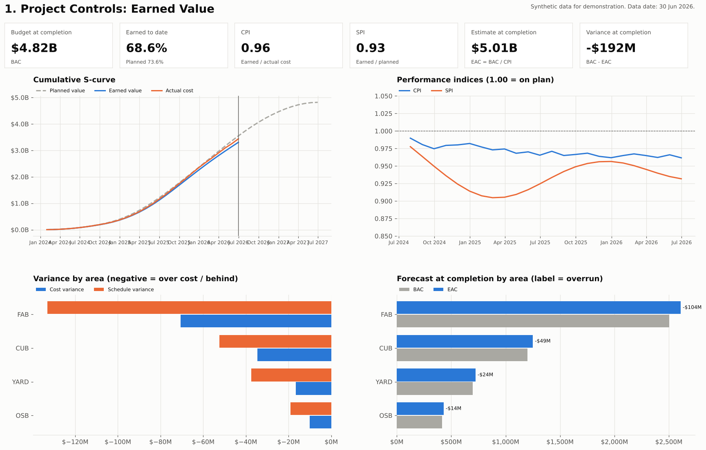
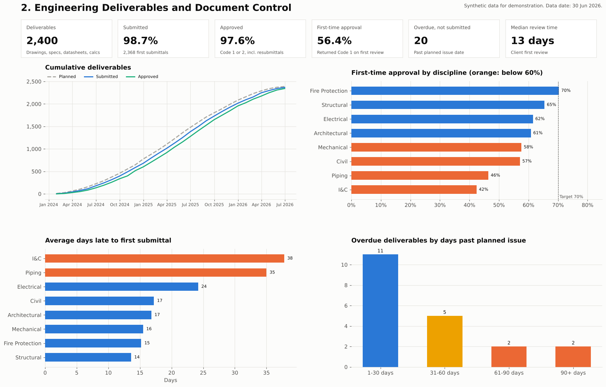
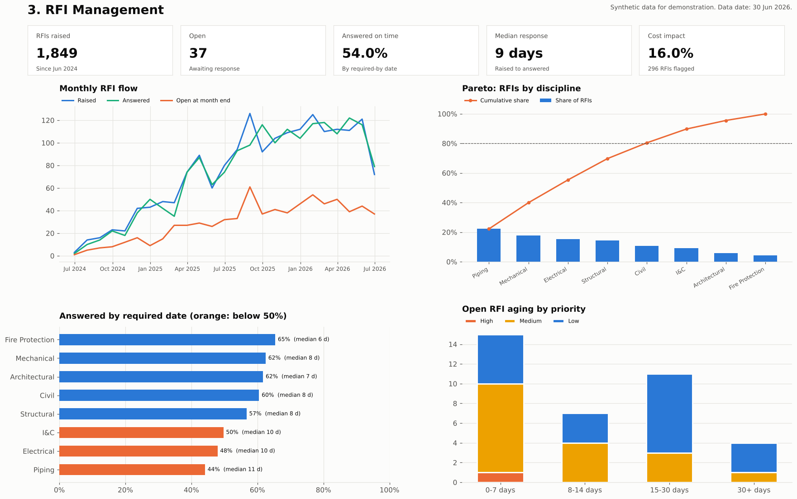
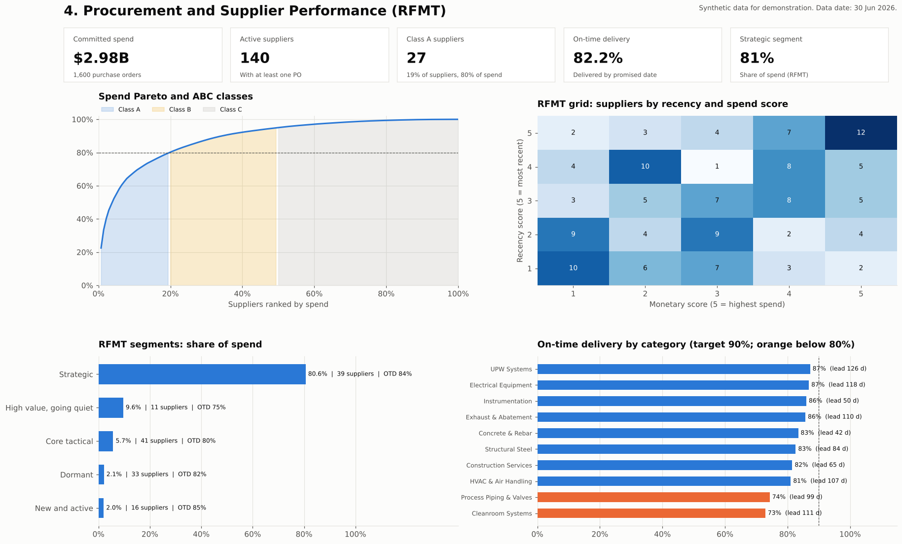
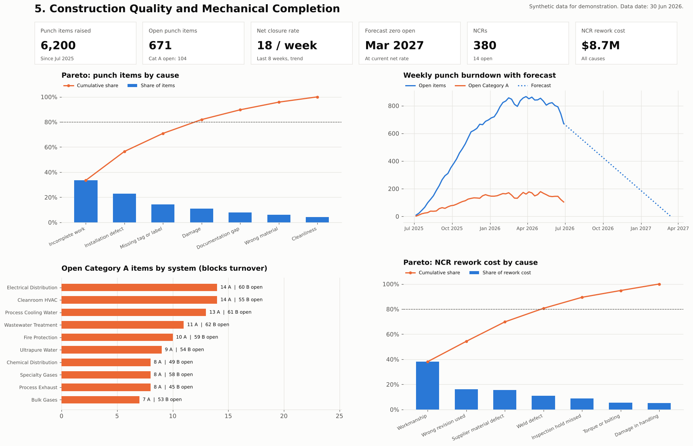

# EPC Project Analytics Dashboards

Five project dashboards for a large semiconductor fab EPC (engineering, procurement, construction) project, covering the reporting a project information and analytics team delivers to project leadership: earned value, engineering deliverables, RFIs, supplier performance with RFMT segmentation, and construction quality and completion.

**Live interactive dashboards:** https://snehaajmira.github.io/epc-project-analytics-dashboards/

| | |
|---|---|
| **Industry** | EPC / capital projects (semiconductor fab) |
| **Tools** | SQL (DuckDB), Python, pandas, matplotlib, Plotly, GitHub Pages |
| **Analyses** | Earned value (CPI, SPI, EAC, VAC), S-curves, Pareto (80/20), ABC classification, RFMT supplier segmentation, aging analysis, burndown forecasting |
| **Data** | Synthetic, generated from a fixed seed (see Section 5). 13,800 records across 7 tables. Data date 30 Jun 2026. |

---

## 1. Dashboard Index

| # | Dashboard | Audience | Analyses | Interactive |
|---|---|---|---|---|
| 1 | Project Controls | Project manager, project controls | S-curve, CPI/SPI trend, variance by area, EAC vs BAC | [Open](https://snehaajmira.github.io/epc-project-analytics-dashboards/project-controls.html) |
| 2 | Engineering and Document Control | Engineering manager, document control | Deliverable progress, first-time approval, days late, overdue aging | [Open](https://snehaajmira.github.io/epc-project-analytics-dashboards/engineering.html) |
| 3 | RFI Management | Construction and engineering leads | Monthly flow, Pareto by discipline, on-time response, open aging | [Open](https://snehaajmira.github.io/epc-project-analytics-dashboards/rfi.html) |
| 4 | Procurement and Supplier RFMT | Procurement, supply chain | Spend Pareto, ABC classes, RFMT grid and segments, on-time delivery | [Open](https://snehaajmira.github.io/epc-project-analytics-dashboards/procurement.html) |
| 5 | Quality and Completion | Construction, quality, commissioning | Punch Pareto, burndown with forecast, Category A by system, NCR Pareto | [Open](https://snehaajmira.github.io/epc-project-analytics-dashboards/quality.html) |

## 2. Dashboards

### 2.1 Project Controls: Earned Value



| Readout | Value |
|---|---|
| Earned vs planned | 68.6% earned vs 73.6% planned |
| CPI / SPI | 0.96 / 0.93 (over cost and behind schedule) |
| Estimate at completion | $5.01B vs $4.82B budget (-$192M) |
| Largest overrun | FAB area, -$104M at completion |

### 2.2 Engineering Deliverables and Document Control



| Readout | Value |
|---|---|
| Progress | 98.7% of 2,400 deliverables submitted, 20 overdue |
| First-time approval | 56.4% overall; I&C (42%) and Piping (46%) lowest |
| Lateness | I&C and Piping average 35+ days late to first submittal, about twice the average of other disciplines (17 days) |

### 2.3 RFI Management



| Readout | Value |
|---|---|
| Volume | 1,849 RFIs, 37 open |
| Response | 54.0% answered by the required date; median 9 days |
| Pareto | Piping, Mechanical, Electrical, and Structural raise about 70% of RFIs |
| Lowest on-time rate | Piping (44%), Electrical (48%), I&C (50%) |

### 2.4 Procurement and Supplier Performance (RFMT)



| Readout | Value |
|---|---|
| Spend concentration | 27 of 140 suppliers (19%) hold 80% of $2.98B committed spend |
| RFMT | 39 Strategic suppliers hold 80.6% of spend; 11 high-value suppliers are going quiet (9.6% of spend, 75% OTD) |
| On-time delivery | 82.2% overall; Cleanroom Systems (73%) and Process Piping and Valves (74%) lowest |

### 2.5 Construction Quality and Mechanical Completion



| Readout | Value |
|---|---|
| Punch list | 671 open (104 Category A) of 6,200 raised |
| Forecast | At the current net closure rate (18 per week), open items reach zero in March 2027 |
| Punch Pareto | Incomplete work, installation defects, missing tags, and damage cause 82% of items |
| NCRs | Workmanship, wrong revision used, and supplier material defects drive 70% of $8.7M rework cost |

## 3. Analysis Methods

| Method | Where used | Definition |
|---|---|---|
| Earned value | Dashboard 1 | CPI = EV / AC; SPI = EV / PV; EAC = BAC / CPI; VAC = BAC - EAC |
| S-curve | Dashboards 1, 2 | Cumulative planned vs actual over time |
| Pareto (80/20) | Dashboards 3, 4, 5 | Categories ranked by share, with cumulative share against an 80% line |
| ABC classification | Dashboard 4 | A = suppliers making up the first 80% of spend, B = next 15%, C = last 5% |
| RFMT segmentation | Dashboard 4 | Recency (days since last PO), Frequency (PO count), Monetary (total spend), Tenure (days since first PO), each scored 1 to 5 by quintile, then mapped to segments |
| Aging buckets | Dashboards 2, 3 | Open items grouped by days past due or days open |
| Burndown forecast | Dashboard 5 | Linear trend of open items over the last 8 weeks, projected to zero |

### RFMT segment rules

| Segment | Rule | Action |
|---|---|---|
| Strategic | Monetary 4-5, Frequency 4-5, Recency 3-5 | Executive relationship, expediting priority |
| High value, going quiet | Monetary 4-5, Recency 1-2 | Confirm remaining scope and delivery risk |
| New and active | Tenure 1-2, Recency 4-5 | Onboarding and quality surveillance |
| Dormant | Recency 1-2, Frequency 1-2 | Close out open POs |
| Core tactical | All others | Standard management |

## 4. Data Model

| Table | Rows | Grain | Feeds |
|---|---:|---|---|
| `control_accounts` | 32 | Area x discipline | 1 |
| `ev_monthly` | 1,344 | Control account x month | 1 |
| `engineering_documents` | 2,400 | Deliverable | 2 |
| `rfis` | 1,849 | RFI | 3 |
| `purchase_orders` | 1,600 | Purchase order | 4 |
| `punch_items` | 6,200 | Punch item | 5 |
| `ncrs` | 380 | Nonconformance report | 5 |

All KPI logic is in SQL (`sql/01` to `sql/05`) so it can be moved to a warehouse or Power BI dataset without rewriting.

## 5. About the Data

All data is synthetic. `src/generate_data.py` builds it from a fixed random seed with realistic patterns (S-curve progress, discipline-specific delays, Pareto-distributed supplier spend, gamma-distributed response times). It does not contain, and is not derived from, any real project, client, or company data. Readouts in Section 2 show how each dashboard would be read and are not real project results.

## 6. How to Run

```bash
pip install -r requirements.txt
python src/generate_data.py     # optional: rebuild the synthetic data
python src/build.py             # KPI tables, static PNGs, interactive HTML
python -m unittest discover -s tests -v
```

## 7. Repository Structure

```
epc-project-analytics-dashboards/
├── data/                       # synthetic source tables (CSV)
├── sql/
│   ├── 00_staging.sql
│   ├── 01_project_controls.sql
│   ├── 02_engineering.sql
│   ├── 03_rfi.sql
│   ├── 04_procurement.sql      # RFMT, ABC, on-time delivery
│   └── 05_quality_completion.sql
├── src/
│   ├── generate_data.py
│   ├── kpis.py                 # runs SQL, burndown forecast
│   ├── static_dashboards.py    # README images
│   ├── interactive_dashboards.py  # GitHub Pages site
│   ├── build.py
│   └── style.py
├── dashboards/static/          # PNG dashboards
├── docs/                       # interactive site (GitHub Pages)
├── outputs/tables/             # KPI tables (CSV)
├── tests/test_kpis.py          # reconciliation checks
└── requirements.txt
```
