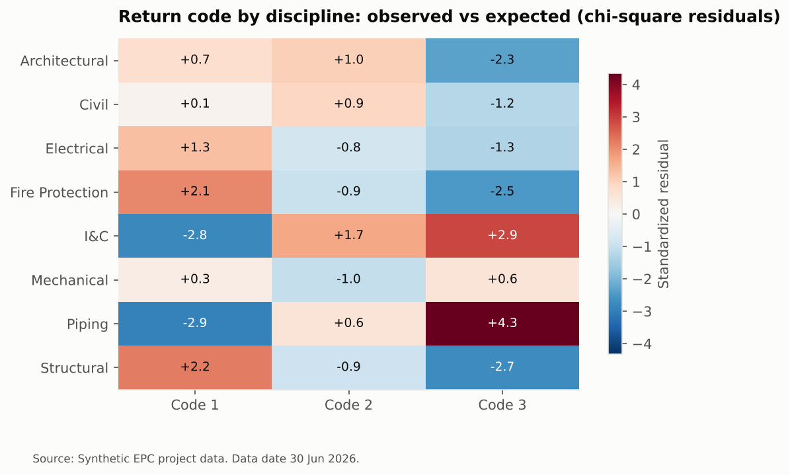
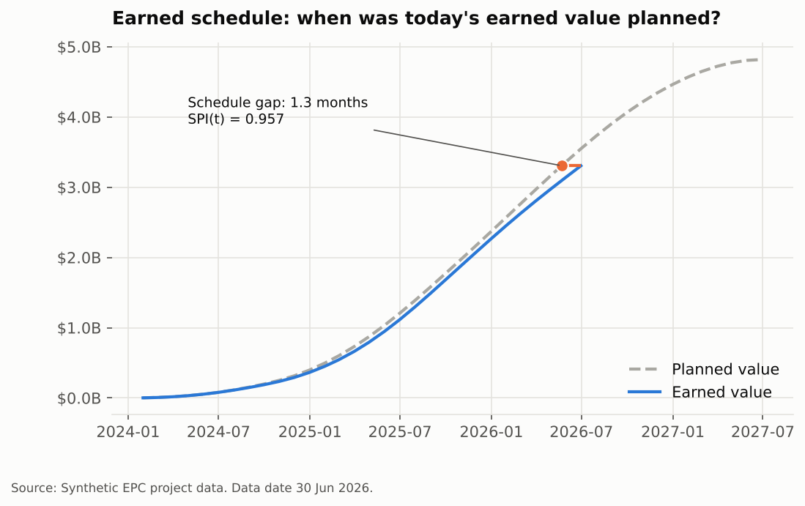
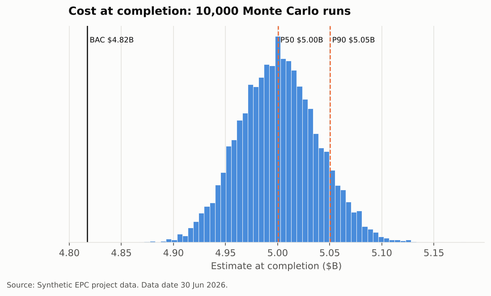
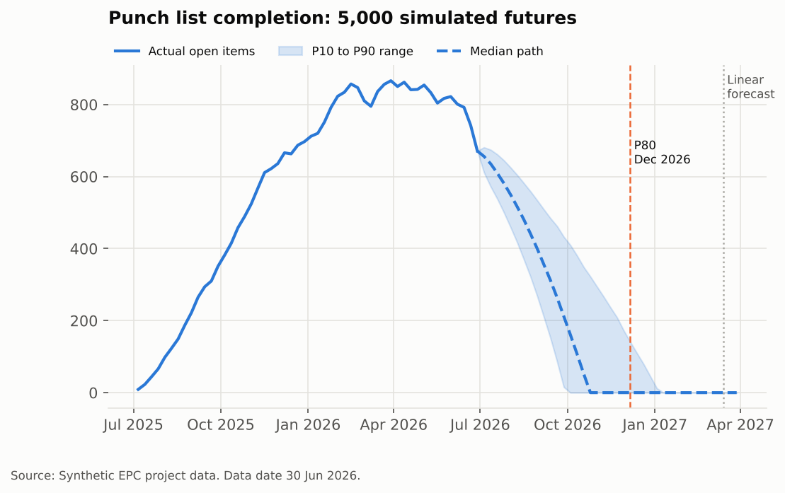
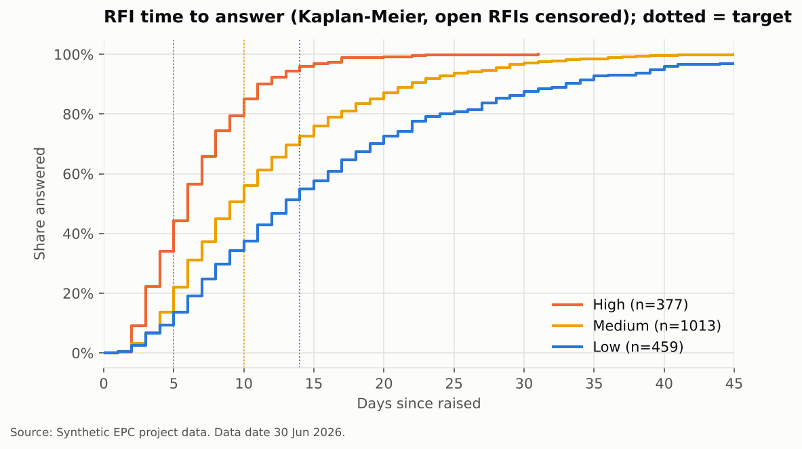
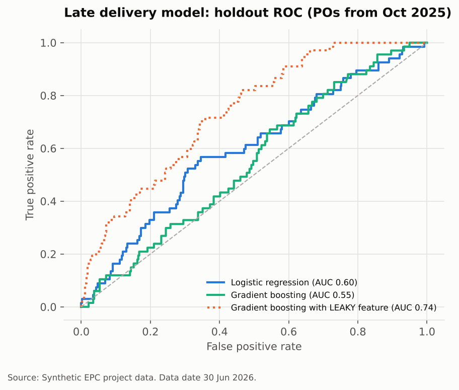
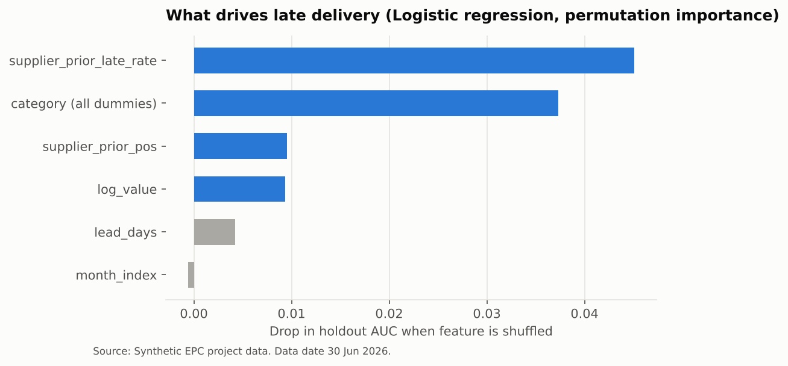
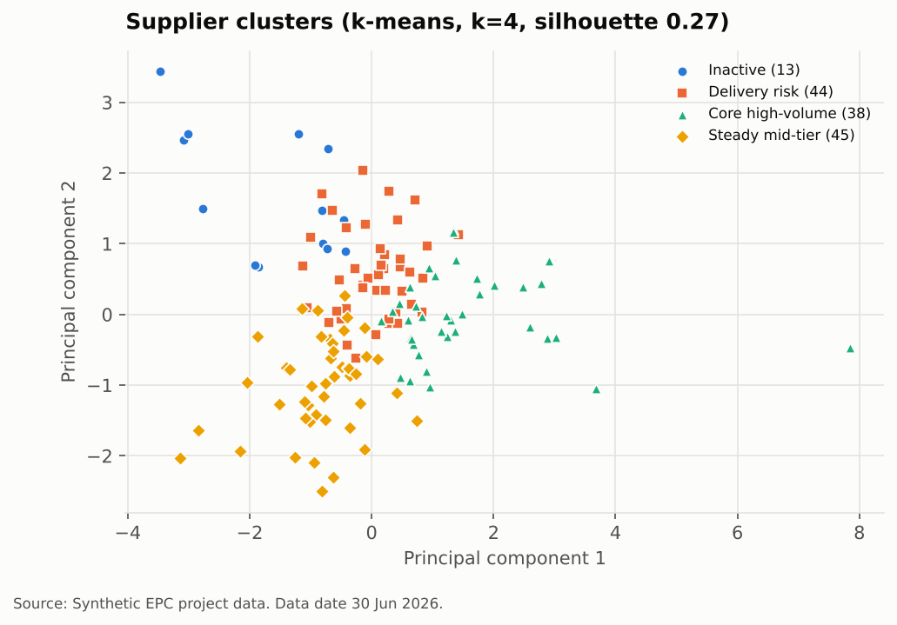
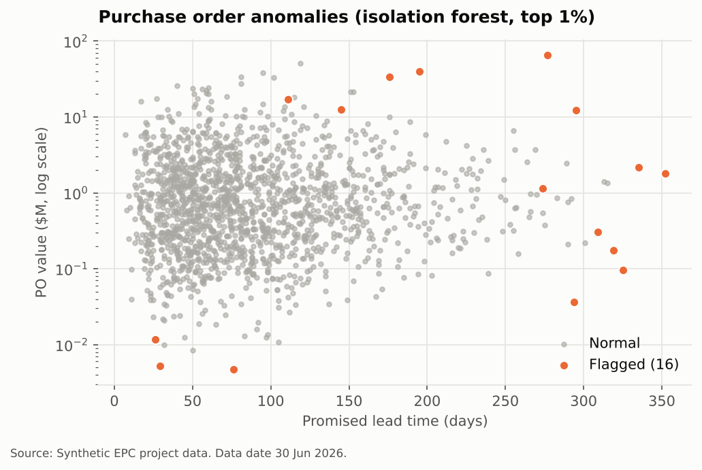

# EPC Project Analysis Report: From Descriptive to Predictive

End-to-end analysis of a semiconductor fab EPC project, building from data profiling to simulation, survival analysis, and machine learning. Each level answers a harder question than the one before it.

| | |
|---|---|
| **Scope** | 13,805 records across 7 tables: earned value, engineering documents, RFIs, purchase orders, punch items, NCRs |
| **Data date** | 30 Jun 2026 (month 30 of a 42-month plan) |
| **Tools** | SQL (DuckDB), Python, pandas, SciPy, scikit-learn, matplotlib |
| **Data** | Synthetic. Generated from a fixed seed; no real project, client, or company data. |
| **Reproduce** | `python src/advanced_analysis.py && python src/write_report.py` |

---

## Executive Summary

| # | Finding | Level |
|---|---|---|
| 1 | The project is about 1.3 months behind schedule. Earned schedule forecasts completion in **Aug 2027** vs a planned Jun 2027. | 3 |
| 2 | Simulated cost at completion is **$5.00B (P50)** to $5.05B (P90) against a $4.82B budget. The chance of finishing within budget is under 1%. A P80 contingency of **$215M** is needed. | 4 |
| 3 | The punch list is likely to clear by **25 Oct 2026 (P50)**, 06 Dec 2026 at P80, about 4 months earlier than the straight-line forecast, because new items are already tapering. If new items do not taper, the P50 slips to 28 Mar 2027. | 4 |
| 4 | Only 44.3% of high-priority RFIs are answered within the 5-day target, the worst of the three priorities. | 5 |
| 5 | A supplier's own delivery history is the strongest predictor of a late PO, but the signal is modest (AUC 0.60). The riskiest 20% of POs are late 1.5x as often as average. | 6 |
| 6 | Clustering finds a **"Delivery risk"** group of 44 suppliers with 59% on-time delivery that the rule-based RFMT segments spread across 5 groups, including 7 Strategic suppliers. | 7 |

## Analysis Roadmap

| Level | Question | Method |
|---|---|---|
| 1. Data profiling | Can the data be trusted? | Completeness, uniqueness, and logic checks |
| 2. Diagnostic statistics | Are the differences we see real or noise? | Chi-square with Cramer's V, Kruskal-Wallis, Mann-Whitney, Spearman |
| 3. Advanced earned value | When will the project finish, and what will it cost? | Earned schedule (SPI(t)), three EAC methods |
| 4. Simulation | How uncertain are those forecasts? | Monte Carlo: bootstrapped CPI by control account; punch list burndown with uncertain taper |
| 5. Survival analysis | How long do RFIs really take, counting ones still open? | Kaplan-Meier with right-censoring |
| 6. Predictive modeling | Which new POs will be delivered late? | Logistic regression vs gradient boosting, leakage-safe features, time-based split, permutation importance |
| 7. Unsupervised learning | Are there supplier groups or POs the rules miss? | K-means with silhouette selection, PCA, isolation forest |
| 8. Prescriptive | Where should management act first? | What-if scenarios quantified from Levels 2 to 7 |

---

## Level 1. Data Profiling and Quality

**Question:** Is the data complete, unique, and logically consistent enough to analyze?

| Table | Rows | Columns | Null cells % | Duplicate keys | First date | Last date |
|---|---|---|---|---|---|---|
| engineering_documents | 2400 | 10 | 0.8 | 0 | 2024-01-08 | 2026-07-22 |
| rfis | 1849 | 9 | 0.2 | 0 | 2024-06-07 | 2026-06-29 |
| purchase_orders | 1600 | 7 | 1.9 | 0 | 2024-02-11 | 2026-06-29 |
| punch_items | 6200 | 7 | 1.5 | 0 | 2025-07-01 | 2026-06-29 |
| ncrs | 380 | 6 | 0.6 | 0 | 2024-09-01 | 2026-06-26 |
| ev_monthly | 1344 | 5 | 11.4 | 0 | 2024-01-31 | 2027-06-30 |

| Logic rule | Violations |
|---|---|
| Approved before first submittal | 0 |
| RFI answered before raised | 0 |
| PO promised before PO date | 0 |
| Non-positive PO value | 0 |
| Punch closed before raised | 0 |
| Events after data date | 0 |
| Earned value above budget | 0 |

**Result:** No duplicate keys and no logic violations. Null cells are expected: unanswered RFIs, undelivered POs, open punch items, and future months with no earned value yet. These nulls carry meaning and are handled explicitly in later levels (for example, as censored records in Level 5).

## Level 2. Diagnostic Statistics

**Question:** Are the discipline differences on the dashboards statistically real?

| Test | Hypothesis | Statistic | p-value | Conclusion |
|---|---|---|---|---|
| Chi-square | First-review return code is independent of discipline | chi2 = 86.1, df = 14, Cramer's V = 0.135 | < 0.001 | Real but modest association |
| Kruskal-Wallis | RFI response time is the same across disciplines | H = 70.2 | < 0.001 | Response times differ by discipline |
| Mann-Whitney (one-sided) | High-priority RFIs are answered faster than Low | Medians 6 vs 13 days | < 0.001 | Priority is respected |
| Spearman | Disciplines with lower first-time approval raise more RFIs per document | rho = -0.36 | 0.385 | Not significant (n = 8 disciplines) |

**Result:** Piping (+4.3) and I&C (+2.9) receive far more "revise and resubmit" (Code 3) returns than expected. With only 8 disciplines, the link between design quality and field RFIs cannot be confirmed; it should be retested at the drawing level, where the sample is much larger.

## Level 3. Advanced Earned Value: Earned Schedule

**Question:** Cost-based SPI drifts toward 1.00 late in every project and stops measuring schedule. When will this project actually finish?

Earned schedule (ES) finds the date on which today's earned value was planned to be reached.

| Measure | Value |
|---|---|
| Actual time (AT) | 30 months |
| Earned schedule (ES) | 28.72 months |
| SPI(t) = ES / AT | 0.957 (cost-based SPI: 0.932) |
| Forecast duration = planned / SPI(t) | 43.9 months vs 42 planned |
| Forecast completion | **Aug 2027** (planned Jun 2027, slip 1.9 months) |

| Method | EAC | Variance at completion |
|---|---|---|
| CPI method (BAC / CPI) | $5.01B | -$192M |
| Composite (AC + (BAC - EV) / (CPI x SPI)) | $5.12B | -$308M |
| Remaining at plan rate (AC + BAC - EV) | $4.95B | -$132M |

**Result:** The three EAC methods span $4.95B to $5.12B. The composite method is the most conservative because it assumes the schedule delay also costs money. Level 4 replaces this single-point range with a probability distribution.

## Level 4. Monte Carlo Simulation

### 4.1 Cost at completion

**Method:** For each of the 32 control accounts, future cost performance is resampled from that account's own last 12 monthly CPIs, plus a shared project-wide shock so accounts move together. 10,000 runs.

| Percentile | Estimate at completion |
|---|---|
| P10 | $4.95B |
| P50 | $5.00B |
| P80 | $5.03B |
| P90 | $5.05B |
| Budget (BAC) | $4.82B |
| Probability of finishing within budget | 0.0% |

### 4.2 Punch list completion

**Method:** Each simulated week draws raised and closed counts from the last 12 weeks (average 140.4 raised and 157.7 closed per week). New items taper as construction finishes, and the taper rate itself is uncertain (0% to 4% per week, drawn per run). 5,000 runs.

| Scenario | P50 | P80 | P90 |
|---|---|---|---|
| Base (uncertain taper) | 25 Oct 2026 | 06 Dec 2026 | 10 Jan 2027 |
| No taper (new items continue at current rate) | 28 Mar 2027 | 30 May 2027 | |
| Closure rate +20% | 13 Sep 2026 | 27 Sep 2026 | |
| Straight-line trend (dashboard forecast) | 14 Mar 2027 | | |

**Result:** The straight-line forecast on the dashboard is close to the no-taper scenario, so it is a pessimistic view. The simulation gives a range instead of one date and shows which assumption matters most: whether new punch items keep tapering.

## Level 5. Survival Analysis: RFI Time to Answer

**Question:** How long do RFIs take, when 37 RFIs are still open?

Averaging only answered RFIs ignores the open ones, which are often the slowest. Kaplan-Meier treats open RFIs as censored: they count as "not yet answered" for as long as they have been open.

| Priority | RFIs | Still open (censored) | Target | Answered by target | Median | 90% answered by |
|---|---|---|---|---|---|---|
| High | 377 | 1 | 5 days | 44.3% | 6 days | 11 days |
| Medium | 1013 | 17 | 10 days | 56.0% | 9 days | 22 days |
| Low | 459 | 19 | 14 days | 55.0% | 13 days | 33 days |

**Result:** High-priority RFIs are answered fastest in absolute days, but only 44.3% meet their 5-day target, the lowest attainment of any priority. The 5-day target and actual practice are misaligned: either the target needs resourcing or it needs resetting.

## Level 6. Predictive Model: Late Purchase Order Delivery

**Question:** When a PO is placed, can we predict whether it will be delivered late?

| Design choice | Detail |
|---|---|
| Label | Delivered after promised date (POs with a delivery date only) |
| Features | PO value (log), promised lead time, category, month, supplier's prior PO count, supplier's prior late rate |
| Leakage control | Supplier history uses only POs already **delivered before** the new PO was placed |
| Validation | Time-based split: train on POs before 01 Oct 2025 (948), test on later POs (443) |

| Model | Holdout AUC | Valid? |
|---|---|---|
| Logistic regression | 0.596 | Yes |
| Gradient boosting | 0.549 | Yes |
| Gradient boosting with LEAKY feature | 0.736 | No: uses future information |

| Feature | AUC drop when shuffled |
|---|---|
| supplier prior late rate | 0.045 |
| category (all dummies) | 0.037 |
| supplier prior pos | 0.010 |
| log value | 0.009 |
| lead days | 0.004 |
| month index | -0.001 |

**Result:** The best valid model is logistic regression (AUC 0.596). The simpler model wins because the dataset is small. Flagging the top 20% riskiest POs catches 30% of late deliveries at a 22.7% late rate vs 15.1% overall (1.5x lift). That is enough to target expediting, not enough to automate decisions.

**Leakage lesson:** Using each supplier's late rate over all POs, including future ones, raises AUC to 0.74. That model looks better but would fail in production, because the future is not known when a PO is placed.

## Level 7. Unsupervised Learning

### 7.1 Supplier clustering

**Method:** K-means on standardized recency, frequency, log spend, tenure, and on-time delivery. k was chosen from 3 or 4 by silhouette score (k = 4, silhouette 0.27). Scores for k = 2 to 6 ranged from 0.23 to 0.27, so the clusters overlap and should be read as tendencies.

| Cluster | Suppliers | Median spend ($M) | Median POs | Days since last PO | Mean OTD % |
|---|---|---|---|---|---|
| Inactive | 13 | 1.1 | 3.0 | 421.0 | 92.6 |
| Delivery risk | 44 | 5.3 | 5.0 | 80.5 | 59.1 |
| Core high-volume | 38 | 23.1 | 17.0 | 27.0 | 88.0 |
| Steady mid-tier | 45 | 2.6 | 4.0 | 65.0 | 94.6 |

**Cluster vs RFMT segment (supplier counts):**

| cluster_name | Core tactical | Dormant | High value, going quiet | New and active | Strategic |
|---|---|---|---|---|---|
| Core high-volume | 5 | 0 | 4 | 0 | 29 |
| Delivery risk | 19 | 10 | 5 | 3 | 7 |
| Inactive | 2 | 11 | 0 | 0 | 0 |
| Steady mid-tier | 15 | 12 | 2 | 13 | 3 |

**Result:** RFMT rules segment on buying behavior only. Adding delivery performance surfaces a "Delivery risk" cluster that spans 5 of the 5 RFMT segments, including 7 Strategic suppliers. A supplier can be Strategic by spend and still be a delivery risk.

### 7.2 Purchase order anomaly detection

**Method:** Isolation forest on PO value, lead time, and both measured relative to the category median. Top 1% flagged (16 POs).

| PO | Category | Value | Lead days | Value vs category median |
|---|---|---|---|---|
| PO-00994 | Exhaust & Abatement | $64,921,200 | 277 | 106.9x |
| PO-00646 | HVAC & Air Handling | $12,161,900 | 295 | 14.5x |
| PO-00723 | HVAC & Air Handling | $36,100 | 294 | 0.0x |
| PO-01252 | HVAC & Air Handling | $95,700 | 325 | 0.1x |
| PO-00525 | Concrete & Rebar | $17,188,000 | 111 | 41.2x |

**Result:** Flagged POs combine unusual value with unusual lead time for their category. These are candidates for a commercial review (price check, scope check, or data entry error), not proof of a problem.

## Level 8. Prescriptive: Where to Act First

| # | Action | Evidence | Quantified effect |
|---|---|---|---|
| 1 | Add a design-review checkpoint for Piping and I&C before client submittal | Level 2: Code 3 rate 28.7% vs 16.2% elsewhere | About 89 fewer Code 3 returns and 182 fewer resubmittal cycles at the other disciplines' rate |
| 2 | Hold P80 cost contingency of $215M | Level 4: P80 EAC $5.03B | Funds the overrun in 80% of simulated outcomes |
| 3 | Target FAB productivity first | Level 3: FAB CPI 0.96, $0.8B of work remaining | Each +0.02 CPI on remaining FAB work saves about $17M |
| 4 | Add punch closure capacity (+20%) | Level 4: closure-rate scenario | P80 completion moves from 06 Dec 2026 to 27 Sep 2026 (10 weeks earlier) |
| 5 | Re-baseline or resource the 5-day high-priority RFI target | Level 5: 44.3% attainment | Align target with practice so it drives real escalation |
| 6 | Expedite the top 20% of POs by predicted late risk, prioritizing the "Delivery risk" cluster | Levels 6 and 7 | Covers 30% of late deliveries with 20% of expediting effort |

## Method Notes

- All figures and tables are generated by `src/advanced_analysis.py`; this report is generated from its output by `src/write_report.py`, so numbers cannot drift from the code.
- Random seeds are fixed, so the simulations and models reproduce exactly.
- Because the data is synthetic, some patterns (for example Piping and I&C performance) were built into the generator. The value of this report is the method: each technique would be applied the same way to real project data.
